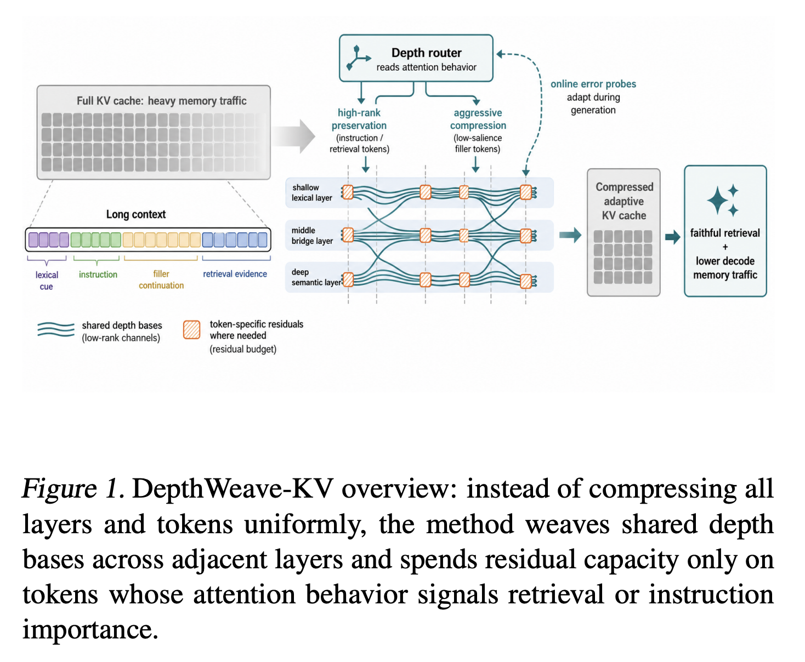
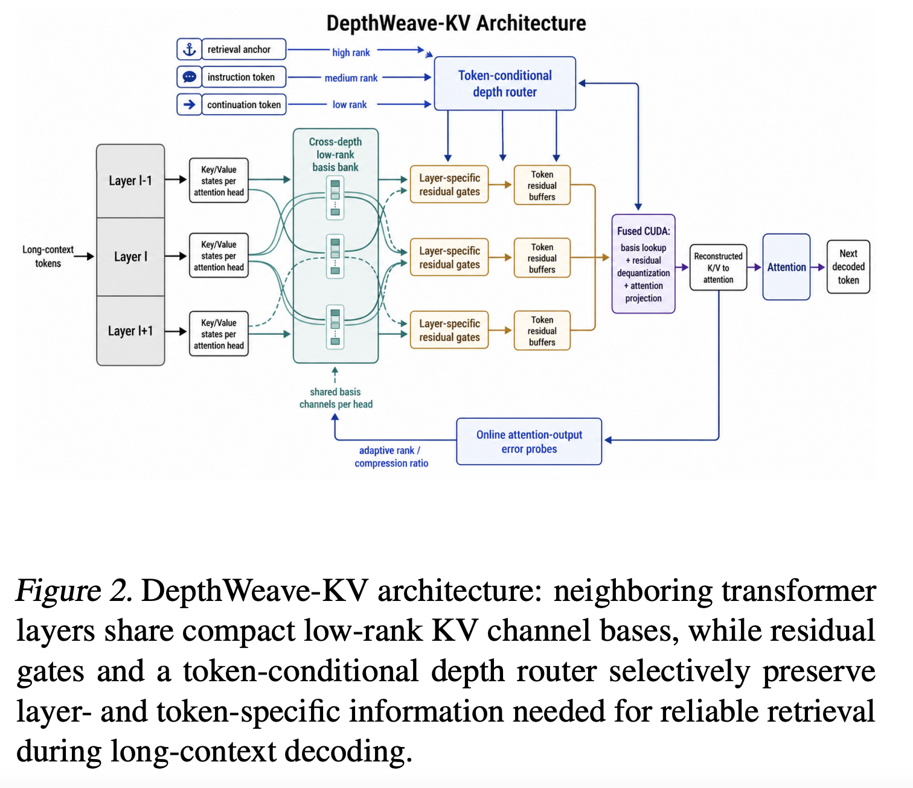

This page reviews the paper [@cordoba2026depthweave] published and submitted on July 2026.

## What is DepthWeave-KV?

First of all, what does term "DepthWeave" represent?

If we separate the term Depth and Weave, it is easier to understand.

In a general transformer model, there is a sequence of transformer layers, also called a transformer block. Each layer has its own Query, Key and Value block, and each also has its own learned parameters.

The term "Depth" represents exactly this transformer layer. Since neighboring layers have a more impact on each other, the idea of combining the adjacent layers for a compression (Depth-wise) Compression is suggested.

Then, What is Weave? The term "Weave" in English is familiar when we think about threading for clothes, and this intuition also helps to understand the term "Weave" in the paper. It mainly represents how the method interaces shared information across transformer depth. The details of the method will be explained in the later section.

Therefore, "DepthWeave" broadly describes the weaving of representations across Transformer layers ("Weave") along the model’s depth dimension (Depth).

## Depth-wise Vs. DepthWeave

It is also crucial to acknowledge the difference between Depth-wise and DepthWeave KV compression.

The basic depth-wise compression only considers the similarity of KV states between adjacent transformer layers. For example, Suppose there are three neighboring layers $X_{1,t}^Z, X_{2,t}^Z, X_{1,t}^Z$ where $Z \in \{K, V\}$. Then, we can make them as one representative KV state or one shared low-ranked basis. Conceptually, combined representation can be $$\hat{X}_{l,t} = A_{l,t}B^Z$$ where $B^Z$ is the shared basis across three layers. ($A_{l,t}$ here is the token and layer-specific coefficient)

On the other hand, Depthweave is a more flexible form of this depth-wise compression). In addition to the shared basis across layers, it also preserves the differences between layers and tokens. Conceptually, $$\hat{X}_{l,h,t}^Z = A_{l,h,t}^ZB^Z_{m,h} + g^Z_{l,h,t}R^Z_{l,h,t}$$ where $B^Z_{m,h}$ is the shared basis for a window of neighboring layers, $A_{l,h,t}^Z$ is the coefficient specific to the layer and token, $g_{l,h,t}^Z$ is a gate-controlling how much residual correction is applied and $R_{l,h,t}^Z$ is the residual that restores information lost by shared basis. So, after aggregating adjacent layers in the same window $m$, the token-specific residuals are given with a learned value of gate-controlling coefficient. (Here, $h$ represents the attention head.)

So, DepthWeave not only considers the similarity between adjacent layers, but also controls the token-specific residual for a better accuracy.

## Limitations of Prior KV Compression Methods (mentioned in the paper)

There are two limitations of Prior KV compression Methods mentioned in the paper.

First, prior KV compression including token eviction, token merging, quantization, low rank attention and layer-wise cache sharing has reduced the KV-cache memory, but many of them rely on static or locally observed token-importance signal (ignore the fact that the unimportant current token can be important later). Also, since each layer encode different information, the same token is represented differently across transformer layers. And the paper mentions that "the transformer layers that encode shallow lexical anchors and deeper semantic abstractions do not require the same cache fidelity". (But many of compression methods miss this fact)

Second, they specifically mentioned the "Depth-wise KV compression alone is insufficient for heterogeneous long-context workloads". Since Depth-wise KV compression only considers the layer combination, it does not consider that "the same token can demand different treatment in early lexical layers and later semantic layers".

## Four Important Contributions

### 1. Cross-depth residual factorization

The shared basis channels per attention head ($B^Z_{m,h}$) are stored and layer-specific key/value states through lightweight learned residual gates ($g^Z_{l,h,t}$) are reconstructed.

### 2. Token-Conditional depth router

The depth router decides residual budget for a specific token. The allocation budget and rank is determined by this depth router. The paper describes practical residual rank-levels such as $\rho \in \{0,2,4,8\}$. The $\rho$ value is determined by the equation, $$\rho_{m,h,t} = \rho_{min}+(\rho_{max}-\rho_{min}) \cdot 1[\sigma (u^T\phi_{m,h,t})>\tau_m]$$

where $\phi_{m,h,t}$ denotes the feature vector , $u$ is a small learned router parameter shared across layers in the window, and $\tau_m$ is an adaptive threshold chosen to satisfy the current memory budget.

Especially, the feature vector $\phi_{m,h,t}$ represents the information about how important the token appear to be, and the paper uses online metadata features rather than running another full neural network model through the base model. Also, the router computes $u^T \phi_{m,h,t}$, a weight combination of the features, and by applying sigmoid function, we can interpret $\sigma(u^T\phi_{m,h,y})$ as token importance or high-rank routing score (if it is close to 1: safe to compress aggressively, if it is close to 0: needs a faithful residual). Finally, by using threshold value $\tau_m$, we can determine the final value of residual rank-level $\rho_{m,h,t}$.

### 3. Calibration-free online error tracking using attention-output probes

Normally, the rank-level $\rho$ is determined with a calibration dataset (for example, given 1000 long context prompts, the rank-level for layer 24-27 is 8, ...).

Instead, DepthWeave chooses a small subset of attention heads and a few recent query positions for every $p$ decoing steps, and it observes the reconstruction error on the prompt currently being processed and adjusts its threshold $\tau$ during generation.

By using the attention-output probes equation,

$$e_{l,h} = \frac{||Attn(Q_{l,h}, K_{l,h},V_{l,h})-Attn(Q_{l,h},\hat{K}_{l,h}, \hat{V}_{l,h})||}{||Attn(Q_{l,h}, K_{l,h}, V_{l,h})||_2+\epsilon} $$

The discrepency is measured, and depending on its value, the threshold $\tau$ is adjusted.

(\*Here, $Attn(Q_{l,h}, K_{l,h}, V_{l,h})$ is computed from the higher fidelity reference which is created temporaily with a more accurate and less compressed method)

### 4. Fused CUDA Implementation

A fused CUDA implementation means that several operations that would normally runs on the separate GPU kernels are combined into one custom CUDA kernel.

For DepthWeave-KV, the fused kernel combines

$$ \scriptstyle
\text{Basis Lookup} \rightarrow \text{Coefficient Multiplication} \rightarrow \text{Residual Dequantization} \rightarrow \text{KV Reconstruction} \rightarrow \text{Attention Computation}
$$

Instead of storing full Key and Value matrix in a global memory, it uses stored shared basis, basis coefficients, quantized residual components, residual quantization metadata, routing information and learned gate parameters to calculate the attention output.

Furthermore, since final attention output is a weighted sum of value vectors, the temporary value vector, $\hat{V}_t$, can be discarded, and final attention output is calculated without storing and using full complete value matrix $\hat{V}_{l,t}$.

The fused kernel ensures that these compressed bytes remain compressed until they are already inside the attention computation. The paper describes this as **compression-aware execution**.

## Figure Explanation

{width="489"}

{width="468"}
