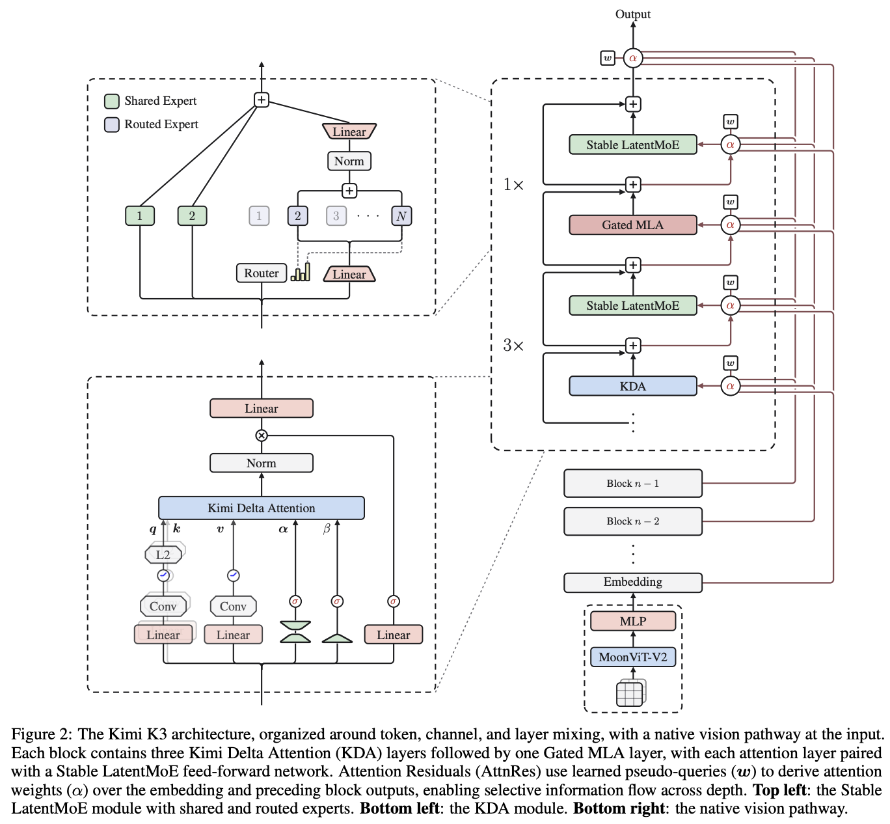

This page reviews the paper, "Kimi K3: Open Frontier Intelligence" published on July 2026

## Frontier LLMs

There are well-known frontier LLMs which are leading the current global markets (GPT, Claude, Gemini and etc.), and it is also known that some of them are specialized in some areas.

## Some characteristics of Kimi K3

1.  There are a total of 2.8 trillion parameters, but only 104 billion parameters are activated underlined by its MoE structure
2.  It also has native vision capabilities and 1 million token context length
3.  It is built on Kimi Delta Attention (KDA) and Attention Residuals
4.  Stable Latent MoE is utilized to select routed experts

## Three important blocks

1.  Stable LatentMoE Module
2.  KDA Module
3.  Native vision pathway

## Three complementary dimensions

1.  Sequence Length: For sequence length, hybrid attention combines three Kimi Delta Attention layers with one Gated MLA layer in each block (efficient mechanism for long-context token mixing while retaining selective high-capacity attention).
2.  Network Depth: Along the depth dimension, Attention Residuals (AttnRes) enable each module to selectively retrieve representations from embeddings, the current block, and proceeding blocks (extending information access beyond sequential residual accumulation)
3.  Along the width dimension, each attention layer is followed by a stable LatentMoE layer that performs sparse channel mixing, effectively activating 16 of 896 routed experts for each token.

## More about Hybrid Attention (3 KDAs + 1 Gated MLA)

### Kimi Delta Attention (KDA)

KDA extends the delta-rule recurrence with a channel-wise forget gate $$S_t = (I-\beta_tk_tk_t^T)\text{Diag}(\alpha_t)S_{t-1}+\beta_tk_tv_t^T$$ $$ \tilde{o}_t = S_t^Tq_t \space \text{(output)}$$ where $\alpha_t \in (0,1)^{d_k}$ is the channel-wise one-step retention factor, and $\beta_t \in (0,1)$ controls the delta-rule write strength

For channel-wise forgetting, it basically represents how much we retain each channel by using retention factor $\alpha_t$.

$$\bar{S}_{t-1} = \text{Diag}(\alpha_t)S_{t-1}$$

where $$\text{Diag}(\alpha_t)=
\begin{bmatrix}
\alpha_{t,1} & 0 & \cdots \\
0 & \alpha_{t,2} & \cdots \\
\vdots & \vdots & \ddots
\end{bmatrix}$$ Also, current prediction for $k_t$ is $\hat{V}_t = \bar{S}_{t-1}^Tk^t$.

#### More about Delta-rule

A basic Hebbian update for the memory $S_t$ is $$S_t = \bar{S}_{t-1} + \beta_t k_t v_t$$ It is very simple and straightforward, but the problem is that even if the approximate value $\hat{v}_t$ is nearly correct, we need to compute the full vector $v_t$ again, which can cause repeated information to be accumulated and interfere with other memories.

To mitigate this problem, we can use the prediction error $e_t = v_t - \hat{v}_t$. Then, the memory update is $$S_t = \bar{S}_{t-1} + \beta_t k_t (v_t-\bar{S}_{t-1}^T k_t)^T \\ = \bar{S}_{t-1}+\beta_tk_tv_t^T - \beta_tk_tk_t^T\bar{S}_{t-1} \\ = (I- \beta_tk_tk_t^T) \bar{S}_{t-1} + \beta_t k_tv_t^T \\ = (I- \beta_tk_tk_t^T)\text{Diag}(\alpha_t) S_{t-1} + \beta_t k_t v_t^T$$ which is exactly stated in the paper.

We can also notice that it is simply a one gradient step on:

$$L_t = \frac{1}{2}||\bar{S}_{t-1}^T k_t-v_t||^2 \\ 
\nabla_S L_t  = k_t(\hat{v}_t - v_t)^T$$

Therefore, $$ S_t = \bar{S}_{t-1} + \beta_t \nabla_S L_t = \bar{S}_{t-1} + k_t(\hat{v}_t - v_t)^T$$

### So what does $S_t$ represent?

$S_t$ is simply a memory prediction. However, from the above illustration, we can view it in a more detailed way.

From delta rule, we acknowledge that it uses the error term ($e_t$) and also accounts for decayed old memory by using channel-wise forgetting factor $\alpha_t$.

Thus, $S_t = \text{decayed old memory} (\alpha_t) + \text{prediction error correction} (e_t)$

In plain words, $S_t$ stores the memory for old states (more memory to fresh states) and also prediction error for current prediction. So, we can use the flexible memory $S_t$ to predict the current value for $k_t$.

### How KDA parameterizes

There are several parameters which KDA generates for the model (KDA parameterizes the per-head quantities),

- $q_t^h, k_t^h = L_2Norm(Swish(ShortConv(W_{q/k}^hx_t))) \in \mathbb{R}^{d_k}$
- $v_t^h = Swish(ShortConv(W_v^h x_t)) \in \mathbb{R}^{d_v}$
- $\beta_t^h = Sigmoid(W_b^hx_t) \in (0,1)$
- $z_t^h = W_{\alpha}^{\uparrow} W_{\alpha}^{\downarrow}x-t + b_\alpha^h \in \mathbb{R}^{d_k}$

#### Query and Key generation

$$q_t^h = k_t^h = L2Norm(Swish(ShortConv(W_{q/k}^hx_t))) \in \mathbb{R}^{d_k}$$

The ShortConv (*short convolution*) involves current token and previous tokens by multiplying with their learned weights. For example, after query/key projection with the learned weights $W_{q/k}^h$ and input $x_t$,the ShortConv involves previous tokens to give more flexibility on feature extraction. (\*new learnable weights: $c_{i,t}$ for channel $i$ and token i, and early query projection: $q'_{t, i}$, Shortconv gives $\tilde{q}_{t,i} = c_{i,0}q_{t,i}' + c_{i,1}q'_{t-1, i} + c_{i,2}q_{t-2, i}'$).

Then, use Swish activation function which has advantages over Relu as it activates negative values.

Finally, we normalize (L2) these values for numerical stability.

#### Value generation

$$ Swish(ShortConv(W_v^hx_t)) \in \mathbb{R}^d_v$$ Value generation is almost same as key/query generation except it does not normalize as we need magnitude of the values for the final feature extraction.

#### Delta-rule coefficient $\beta_t^h$ generation

