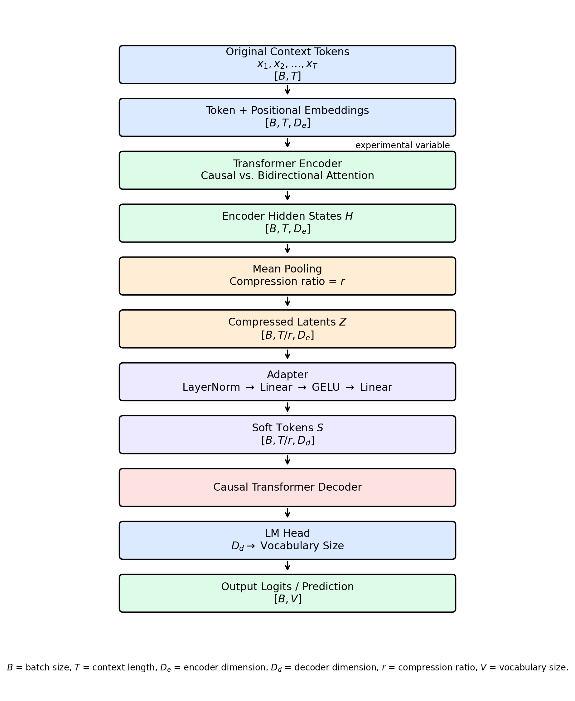

## About this study..

From latent context language model (LCLM), the author highlights that (for encoder attention masking) LCLM performs better on Causal masking set-up than on bidirectional setting.

Since the bidirection makes query to look at entire context or every token, it is natural to think that bidirectional setting would be more accurate. However, the encoder is based on the pre-trained Qwen model which is trained under causal attention, and the pooling from causal attention gives useful hierarchical/accumulating structure to the latent vectors.

From these reasons, we can assume why causal attention performs better than bidirectional attention in LCLM.

To confirm these facts, we will investigate bidirectional and causal attention with pooling on small LCLM.

## Setting

| Component         | Setting                    |
|-------------------|----------------------------|
| Encoder           | small transformer          |
| Encoder mask      | causal Vs. bidirection     |
| Encoder Window    | 256 tokens initially       |
| Compression       | 4x                         |
| Pooling           | mean                       |
| Adapter           | 2 layer MLP                |
| Decoder           | same small decoder         |
| Dataset           | synthetic needle retrieval |
| Initialization    | identical                  |
| Training Steps    | identical                  |
| Optimization / LR | identical                  |

## Architecture

$$X \rightarrow \text{Encoder} \rightarrow H \rightarrow \text{Mean Pool} \rightarrow \text{MLP Adapter} \rightarrow S \rightarrow \text{Decoder} \rightarrow \hat{y}$$

As it is illustrated in the setting and architecture, the only difference is the attention mask in encoder. The other settings are same for both models.

## About the Dataset...

To train and test the model, the needle retrieval task is chosen.

It is a very simple task to train and test the language model. First, we generate random tokens with a specific length (for example, it can be 5 random tokens: \[32, 24, 52, 12, 97\]). Then, we insert **KEY** in the random position (between numbers, for example: \[32, 24, **KEY**, 52, 12, 97\]). At the end, with a given query, we train the model to find the number comes after **KEY**.

In addition to the single needle retrieval task, the multi-key retrieval task is also implemented. It is basically same as the single needle retrieval task, but there are several keys in the sample, and the task is to find these keys with given queries (For example: \[32,**KEY_A**, 24, **KEY_B**, 52, 12\], **QUERY_A** and **QUERY_B** are the task to find the number comes after **KEY_A** and **KEY_B** accordingly.)

Also, **before-key** and **before-after-key** (Find number before **KEY** and find numbers which come before and after **KEY**) tasks are trained and tested for both models to verify whether the causal advantage is directly tied to the directionality.

So, the experiment looks like

$$
\begin{array}{c}
\text{Single after-key Retrieval} \\[6pt]
\downarrow \\[6pt]
\text{Multi after-key Retrieval} \\[6pt]
\downarrow \\[6pt]
\text{Multi before-key Retrieval} \\[6pt]
\downarrow \\[6pt]
\text{Multi before-after-key Retrieval (accessorial task)}
\end{array}
$$
Since before-after task introduces extra changes at the same time: two targets instead of one, two output heads instead of one, a harder multitask objective, and a different loss, it becomes harder to know whether the cause was the encoder mask or simply the more difficult two-output task. So, we will focus more on the after-key and before-key Retrieval task.

(*For the multi before-after-key retrieval, it needs two heads structure for the model, the detailed model structure is illustrated in the [Appendix](#appendix).)

## Result

## Appendix {#appendix}
